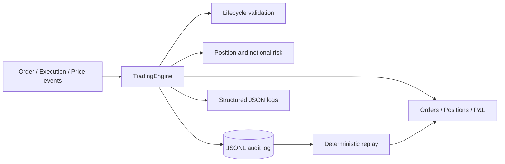

# Event-Driven Trade Lifecycle and Risk Engine

A small, deterministic Python simulation of an event-driven trading engine. It processes orders, executions, and market prices while maintaining order state, positions, realized and unrealized P&L, and pre-trade risk limits.

The project is designed to make correctness visible: duplicate executions are idempotent, every business event is captured in an append-only audit log, and the complete state can be rebuilt by replaying that log.

> This is an educational simulation. It does not connect to a broker or exchange and is not intended for live trading.

## Features

- Event-driven processing for order submissions, cancellations, executions, and price updates
- Validated order lifecycle with `NEW`, `PARTIALLY_FILLED`, `FILLED`, `CANCELLED`, and `REJECTED` states
- Per-symbol net positions with weighted-average cost
- Realized, unrealized, and total P&L using `Decimal`
- Position and notional limits with risk reserved for active orders
- Idempotent execution handling through globally unique execution IDs
- Versioned JSON Lines audit log and deterministic replay
- Candidate-state commit so a persistence failure cannot partially change live state
- Structured JSON logs for accepted, rejected, and ignored events
- Unit and integration tests for normal and failure scenarios
- GitHub Actions checks for Python 3.11 and 3.12

## Architecture



The engine applies each event to a candidate copy of state. It commits that state only after the event is durably appended to the audit log. Rejected and ignored events are also logged, so replay follows the same decisions as live processing.

## Quick start

Requires Python 3.11 or newer.

```bash
python -m venv .venv
# Windows
.venv\Scripts\activate
# macOS/Linux
source .venv/bin/activate

python -m pip install ".[dev]"
python -m pytest
python examples/run_demo.py
```

Run the linter:

```bash
python -m ruff check .
```

## Example lifecycle

```python
from datetime import UTC, datetime
from decimal import Decimal

from trade_engine import OrderSubmitted, RiskLimits, RiskManager, Side, TradingEngine

engine = TradingEngine(
    RiskManager(
        RiskLimits(
            max_abs_position=Decimal("100"),
            max_abs_notional=Decimal("50000"),
        )
    )
)

result = engine.process(
    OrderSubmitted(
        event_id="evt-1",
        occurred_at=datetime.now(UTC),
        order_id="order-1",
        symbol="AAPL",
        side=Side.BUY,
        quantity=Decimal("10"),
        limit_price=Decimal("100"),
    )
)

print(result.status)  # ACCEPTED
print(engine.orders["order-1"])  # NEW order
```

The full demo covers partial and full fills, a duplicate execution, a market-price update, a risk rejection, P&L, event persistence, and replay.

## Domain decisions

### Notional risk

Projected notional is:

```text
abs(projected net position × new order limit price)
```

The projected position includes the current filled position, all remaining quantities on active orders, and the new order. This prevents multiple open orders from individually passing a limit while jointly exceeding it.

### Idempotency

Each execution has a unique `execution_id`. Once an execution is accepted, later messages with the same ID are ignored before any order, position, or P&L state changes. This remains true even if a duplicate message carries different values.

### P&L

- Increasing a position in the same direction updates weighted-average cost.
- Reducing a position realizes P&L against that average cost.
- Crossing through zero realizes the closed portion and sets the new position's average cost to the crossing execution price.
- Unrealized P&L uses the latest market price and is zero before the first price update.

### Replay and failure atomicity

Events use a versioned deterministic JSON representation. A fresh engine processing the file in order produces the same serializable snapshot. Invalid records report their exact line number. If appending an event fails, the candidate state is discarded and live state is unchanged.

Replay requires the same engine version and risk configuration that processed the original audit log. In a production design, those configuration versions would be stored alongside the event stream.

## Project structure

```text
src/trade_engine/
  engine.py        # event dispatch and aggregate state
  event_store.py   # JSONL serialization, persistence, and loading
  events.py        # immutable domain events and enums
  logging.py       # structured JSON logging
  models.py        # order, position, and P&L state
  risk.py          # projected position and notional checks
examples/
  run_demo.py      # synthetic end-to-end scenario
tests/             # unit and integration tests
```

## Test coverage by failure scenario

- Non-positive quantities and prices
- Invalid or terminal lifecycle transitions
- Unknown order IDs and order overfills
- Position and notional limit breaches
- Risk reserved and released by active-order state
- Duplicate event, order, and execution IDs
- Long, short, reduced, closed, and reversed positions
- Malformed, unknown, and truncated event records
- Event-store append failure without partial state mutation
- Exact live-versus-replayed state equality

## Limitations

The engine intentionally omits matching, cash balances, commissions, currencies, derivatives, corporate actions, authentication, concurrency, databases, and external market connectivity. These are separate production concerns and outside this project's focus on lifecycle correctness, risk, idempotency, and replay.

## License

MIT

